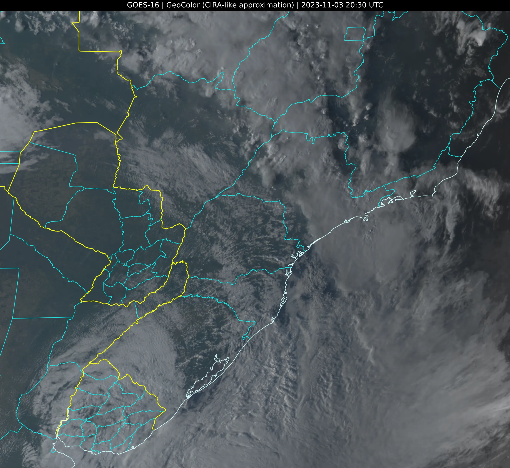
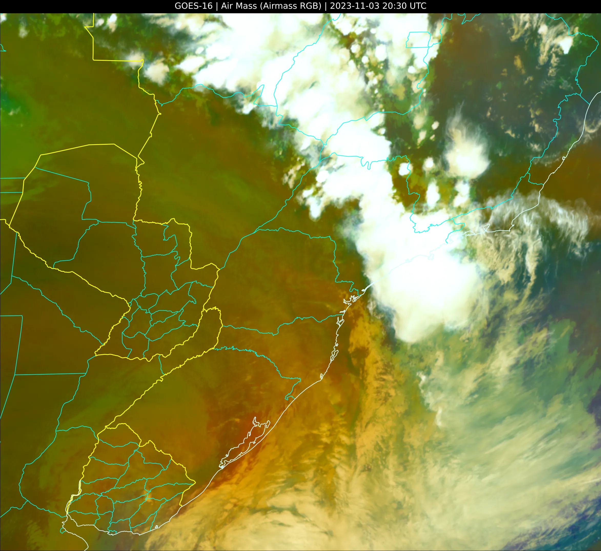
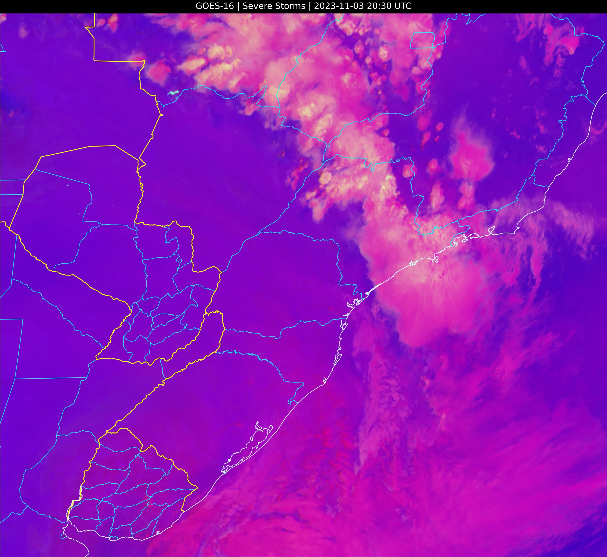
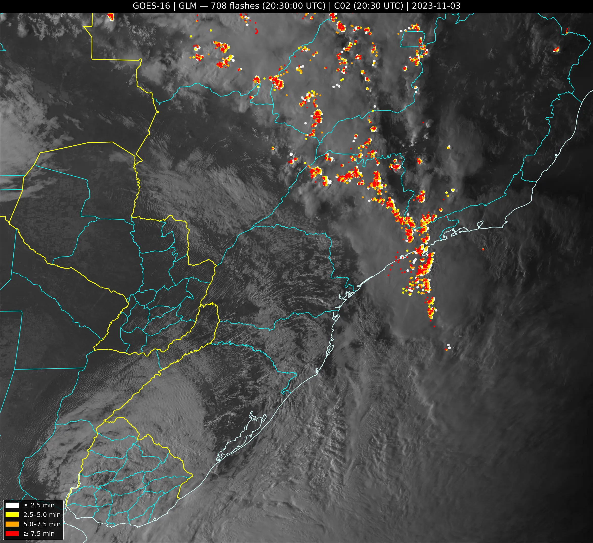

# GOES Image Generator

Generates images and videos from the GOES-16/GOES-19 satellites, focused on South America. It downloads the NetCDF files straight from NOAA's public AWS bucket (anonymous access, no credentials), crops the configured region, applies the palettes/recipes from `colors.ini` and renders everything with matplotlib/cartopy. You can generate a single image, assemble a video with FFmpeg, or just export an image sequence for a period, with no video. The exported image format (png, webp, jpg or tiff) is chosen with `image_format`.

All configuration (product, period, map, colors, performance) lives in `config.ini` and `colors.ini`, with explanations for every parameter. This README covers what the `.ini` files do not explain: the architecture behind `product =`.

---

## What the project supports

Individual ABI bands: `C01` to `C16`. C01-C06 (reflectance) are rendered in grayscale; C07-C16 use the palette in `[PALETTE_C07..16]`.

Multispectral: `GEOCOLOR` (true-color/IR approximation of the CIRA GeoColor product) and `SPLIT_WINDOW` (C13 - C15).

RGB composites: `AIRMASS`, `DAY_CLOUD_PHASE`, `NIGHT_MICROPHYSICS`, `SEVERE_STORMS`, `OVERSHOOTING_TOPS`, `FIRE_TEMPERATURE`. Each one is a recipe in `colors.ini` (physical range, gamma and inversion are free; the bands can only vary among those the product already downloads, listed at the top of the RGB section of `colors.ini`), not hardcoded.

Cloud products: `CLOUD_TOP_HEIGHT` (official `ABI-L2-ACHAF` product) and `CLOUD_BASE_HEIGHT`/`CLOUD_THICKNESS`, which are estimates made by this project (see the warning in `colors.ini` and "Known limitations" below).

GLM: `product = GLM`, configured in the `[GLM]` section of `config.ini`. Two modes (`render_mode`): `POINTS` (individual flashes, color/size by age) and `DENSITY` (2D grid of flash counts). In both modes, `[GLM] background` accepts any product from the list above as the background layer, including another RGB composite, GEOCOLOR or a cloud product. When the background has a colorbar (thermal bands, SPLIT_WINDOW and cloud products), it is drawn to the right of the map. With an empty `background`, the PNG has a truly transparent background (alpha channel), in any `render_mode`, with or without `clean_mode` and `hide_map_lines`. This does not carry over to video: the MP4 has no alpha channel and shows a black background. To get transparent frames, use `generation_type = S` (image sequence, PNGs saved in their own folder inside `output/`) or `generation_type = I`.

Only ABI "Full Disk" images exist, every 10 minutes, scan mode 6 (GOES-16 only switched to this mode in April 2019; CONUS and mesoscale are not supported). GLM (`GLM-L2-LCFA`) has one file every 20 seconds. Automatic satellite switch: before 2025-04-07 15:10 UTC it uses GOES-16; from then on, GOES-19.

### Products and the files each one downloads

Each frame downloads the NetCDF files listed below (one per line of the "Files" column). The more files, the more RAM and network per worker, so tune `num_workers` by looking at this table.

| `product =` | Files per frame | When it makes sense |
|---|---|---|
| `C01` to `C06` | 1 ABI band (`CMIPF`) | Daytime only (reflectance) |
| `C07` to `C16` | 1 ABI band (`CMIPF`) | Day and night (C07 has solar reflection by day) |
| `SPLIT_WINDOW` | C13, C15 | Day and night |
| `AIRMASS` | C08, C10, C12, C13 | Day and night |
| `DAY_CLOUD_PHASE` | C02, C05, C13 | Daytime only |
| `NIGHT_MICROPHYSICS` | C07, C13, C15 | Designed for night |
| `SEVERE_STORMS` | C02, C05, C07, C08, C10, C13 | Daytime only |
| `OVERSHOOTING_TOPS` | C08, C12, C13 | Day and night |
| `FIRE_TEMPERATURE` | C05, C06, C07 | Daytime |
| `GEOCOLOR` | C01, C02, C03, C13 | Day and night (transition by solar angle) |
| `CLOUD_TOP_HEIGHT` | `ACHAF` | Day and night |
| `CLOUD_BASE_HEIGHT`, `CLOUD_THICKNESS` | `ACHAF`, `CODF`, `ACTPF` | Day and night, but it is an estimate and at night COD is only reliable from 1 to 8 |
| `GLM` | 1 GLM file (20 s) + history if `POINTS` with `flash_age = True` + the files of the chosen background | Day and night |

---

### Rendering examples

https://github.com/user-attachments/assets/0e942493-5555-4248-ba88-c960e7482369

<p align="center">
  <small><i>Video mode (C13, infrared, downscaled for GitHub)</i></small>
</p>

<table border="0" width="100%">
  <tr>
    <td align="center" width="50%">
      <br>
      <small><i>GEOCOLOR (true-color by day, IR at night)</i></small>
    </td>
    <td align="center" width="50%">
      <br>
      <small><i>AIRMASS (RGB composite)</i></small>
    </td>
  </tr>
  <tr>
    <td align="center" width="50%">
      <br>
      <small><i>SEVERE_STORMS (RGB composite)</i></small>
    </td>
    <td align="center" width="50%">
      <br>
      <small><i>C02 (visible) with GLM on top</i></small>
    </td>
  </tr>
</table>

---

## Installing

Python 3.10+. Cartopy needs GEOS/PROJ installed on the system, so the smoothest route is Conda:

```bash
git clone https://github.com/ArthurPH25/goes-image-generator.git
cd goes-image-generator
conda create -n goes python=3.11
conda activate goes
conda install -c conda-forge cartopy
pip install -r requirements.txt
```

Plain pip also works, but installing Cartopy becomes a problem of its own depending on the operating system. Sort out GEOS/PROJ before running `pip install`.

FFmpeg does not need to be installed or on the PATH (`imageio-ffmpeg` ships the binary). On a server, use `open_video_when_done = False`. The first run needs internet access so Cartopy can download the borders/coastline data (Natural Earth); subsequent runs use the local cache. With `hide_map_lines = True` that download is not even made.

Adjust `config.ini` (product, date/time, coordinates, performance) and `colors.ini` (palettes/recipes) in the project root and run:

```bash
python main.py
```

It runs from any directory: both `.ini` files are read from the script's folder. Everything is validated before anything is downloaded.

## Architecture: how a product becomes an image

```
config.ini [GENERAL] product = X
        │
        ▼
products/registry.py    knows which files X needs from the NOAA bucket
        │               (SourceSpec) and which function knows how to draw it
        ▼               (renderer)
main.py                 lists and downloads those files for the right timestamp
        │
        ▼
products/<module>.py    reads the NetCDF file(s) and returns a standardized
   (abi / clavr)        LayerResult (kind="mono": 2D array + colormap;
        │               kind="rgb": ready-made (H,W,3) array)
        ▼
products/pipeline.py    draws the LayerResult on the map axes, with lines,
                        colorbar and title where applicable, and the
                        watermark whenever `watermark` is not empty, and
                        saves the image in the image_format format
```

Modules in `products/`: `core.py` (projection geometry, cropping, resampling, `LayerResult`), `abi.py` (ABI band reading, individual bands, SPLIT_WINDOW, RGB composites and GEOCOLOR), `clavr.py` (cloud products), `pipeline.py` (shared drawing), `registry.py` (product, sources and renderer map) and `glm.py` (lightning).

`products/glm.py` does not go through `pipeline.generate_standalone_image`: it has its own flow (`GLM.generate_image`) because it draws points/grid *on top of* an optional background. That background is resolved by the same `pipeline.render_layer()` used by every other product, which is why GLM accepts anything as a background without duplicating drawing logic.

ABI bands of different native resolutions (0.5/1/2 km) appear together in several RGB composites and in GEOCOLOR. `products/core.py::align_bands_to_reference` resamples them all to the grid of the coarsest band in the recipe, by nearest neighbor in scan-angle coordinates (not by pixel index), so geographic alignment holds even with slightly different crop margins between files.

Adding a new product = 4 steps: (1) write a `render(nc_paths, config, colors_config, map_geo, product_spec, target_dt) -> LayerResult` in a `products/` module; (2) register it in `products/registry.py::build_registry()` with its `SourceSpec`s (if the `kind` is new, also add a branch in `validate_product_colors` and, if it can be a GLM background, in `_rebuild_cmap_for_background` in `products/glm.py`); (3) add the matching palette/recipe section in `colors.ini`; (4) add the product name to the list of accepted values in the `[GENERAL]` comments in `config.ini`. There is no need to touch `main.py` or `pipeline.py`.

## Known limitations (read before using in production)

- GEOCOLOR is an approximation: synthetic true-color by day (GOES has no real green band, so green is a combination of C01/C02/C03) and enhanced IR at night, with a transition based on the solar zenith angle computed locally. It has neither the night lights mosaic nor the snow/ice enhancement of the official CIRA product.
- CLOUD_BASE_HEIGHT and CLOUD_THICKNESS are estimates, not an official public product (that product does not exist in the NOAA bucket, and what CIRA/SLIDER shows comes from a separate pipeline). Here, thickness comes from a simple parameterization on top of `COD` (optical depth, `ABI-L2-CODF`) and `Phase` (`ABI-L2-ACTPF`), with coefficients editable in `colors.ini [ESTIMATE_CLOUD_GEOMETRY]`. Use only as an experimental visualization.
- The RGB composite recipes (`RGB_AIRMASS`, `RGB_SEVERE_STORMS`, etc. in `colors.ini`) follow the public NOAA/CIRA quick guides for ABI and the EUMETSAT ones, with one exception: `OVERSHOOTING_TOPS` has no published guide with these numbers, it is an experimental recipe inspired by the Tropical Airmass (details in `colors.ini`). `SEVERE_STORMS` follows EUMETSAT's Severe Storms recipe, with gamma 0.5 on green; NOAA's Day Convection has the same ranges but gamma 1 on green. Gamma follows the EUMETSAT/CIRA convention, output = value ^ (1 / gamma). If you notice a difference against a trusted reference image, adjust `min`/`max`/`gamma` without touching any code.

## How it works internally (execution details)

The validation of `config.ini`/`colors.ini` runs right at the start of `main.py`, before anything touches the network. This step also computes the `render_signature`, a 12-character SHA1 of everything that changes a frame's appearance: product, `[MAP]`, the whole `[STYLE]`, dpi, and the `colors.ini` sections relevant to the active product (including, in the GLM case, those of the background product). Date and time are deliberately left out.

That signature is part of the name of the video frames in `temp/` (`frame_<signature>_*.png`). The frames are deleted as soon as the video is assembled. If a video run dies before that, the next run with the same visual settings reuses the frames already rendered and continues from there. Changing anything visual changes the signature, so stale frames are never reused. Frames from an abandoned configuration stay in `temp/` until a video with that same signature succeeds, or until you delete them by hand.

The S3 search runs sequentially, outside the rendering processes, one listing per hour of data (and per source, when the product needs more than one file: RGBs, cloud or GLM with a background). Rendering distributes each timestamp across `num_workers` separate processes; each worker downloads the files the product needs for that frame.

GLM background in video or image sequence mode: rendered (not just downloaded) once per 10-minute block and kept in a cache (`temp/bg_*.npz`), reused by the ~30 20 s frames of that block. The lock (`.lock`) has a 5 min limit; if it is exceeded, the frame is produced without a background and a warning is shown.

Other edge-case behaviors (satellite missing from the bucket, corrupted PNG, single-instance lock, cleanup of temporary files) work exactly as documented in the comments of `config.ini`.

## Folders

Only two, both created next to `main.py` when needed.

| Path | Contents | Survives between runs? |
|---|---|---|
| `output/<PRODUCT>_<timestamp>.<ext>` | Single image mode (ext according to `image_format`) | Yes, never overwrites |
| `output/<PRODUCT>_<start>_to_<end>/` | Image sequence mode (`<PRODUCT>_<YYYYMMDD>_<HHMM>.<ext>`, GLM with seconds) | Yes, each run creates a new folder |
| `output/<PRODUCT>_<start>_to_<end>.mp4` | Video mode | Yes, never overwrites |
| `temp/frame_<signature>_*.png` | Video mode frames (always PNG) | Only if the video run dies before the video is assembled |
| `temp/instance.lock` | Single-instance lock | No, expires after 24h if left behind |
| `temp/` (everything else) | Downloaded NetCDF files, GLM history and background cache (`.npz`) | No |

`temp/` has no subfolders. At the end of each run everything in it is deleted, except the lock while the run is active and the frames of an unfinished video run, and the folder itself is removed when nothing is left. `output/` is also removed if the run produced nothing.

## Troubleshooting

| Symptom | What to do |
|---|---|
| Validation error right at the start | Read the message: it points to the `.ini` key. Check `product` against the list in `[GENERAL]`, the time format (`HH:MM` vs `HH:MM:SS` for GLM) and any comment on the same line as a value. |
| "File(s) ... not found in the bucket" or "No files found for the configured dates" | One of the files the chosen product needs (ABI band or `ACHAF`/`CODF`/`ACTPF`) does not exist for that instant. Check the date/time in UTC and whether the period is supported. |
| "Another run of this script is already in progress..." | Delete `temp/instance.lock` if you are sure no run is active. |
| GLM without `background` comes out with a black background in the video | That is the MP4, which has no transparency. The PNGs are still transparent: use `generation_type = S` to get them directly in `output/<PRODUCT>_.../`. |
| GLM background always "without background" | Check `[GLM] background` against the list of valid products and whether that product has a complete palette/recipe in `colors.ini`. |
| GLM video with occasional "no background" frames | Too many workers competing for the same background cache. Reduce `num_workers`. |
| The process dies on its own midway | Out of RAM. Reduce `num_workers` first (products with several bands/sources weigh more), then `dpi`/`figure_width`/`figure_height`. |
| Colors of an RGB composite/GeoColor look wrong | Adjust `min`/`max`/`gamma`/`invert` in the matching `[RGB_*]` section of `colors.ini`. They are just numbers, no code changes needed. Gamma below 1 darkens, above 1 brightens. |
| Validation error saying the recipe uses a band the product "does not download" | You swapped a recipe band for another one the product does not download. Use one of the bands listed in `colors.ini` for that product or add the new band to its sources in `products/registry.py`. |
| Error saying `target_coordinates` is outside the visible disk | The crop is in a region GOES-East cannot see (it covers roughly longitudes -156 to 6). Review `[MAP] target_coordinates`. |
| The image shows a different time than expected | All `config.ini` times are UTC. Brasília time is UTC-3, so 16:30 in Brasília is `19:30` in the file. |

## Credits

- Data: NOAA/NASA GOES-R satellites, via [NOAA Open Data Dissemination on AWS](https://registry.opendata.aws/noaa-goes/) (buckets `noaa-goes16` and `noaa-goes19`).
- Maps: [Natural Earth](https://www.naturalearthdata.com/), via Cartopy.
- RGB/GeoColor recipes: public quick guides from EUMETSAT, CIMSS and CIRA (see the accuracy note in `colors.ini`).

## License

[MIT](LICENSE).