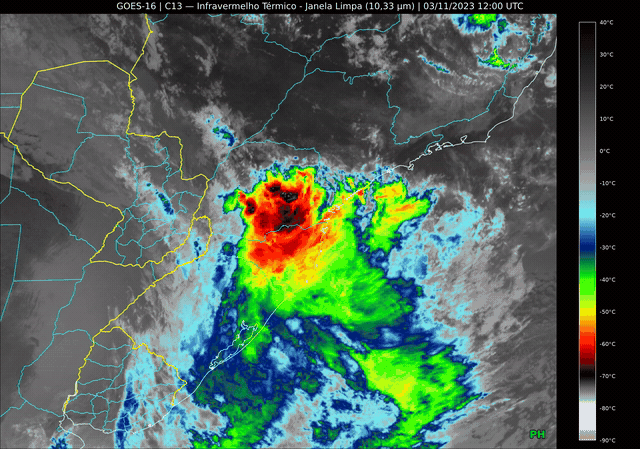
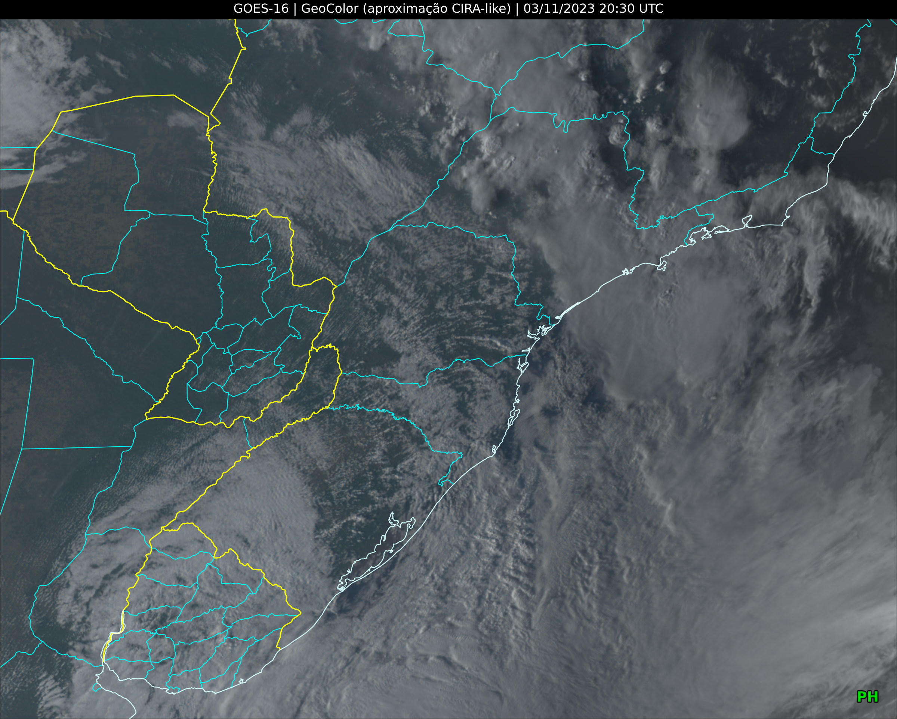
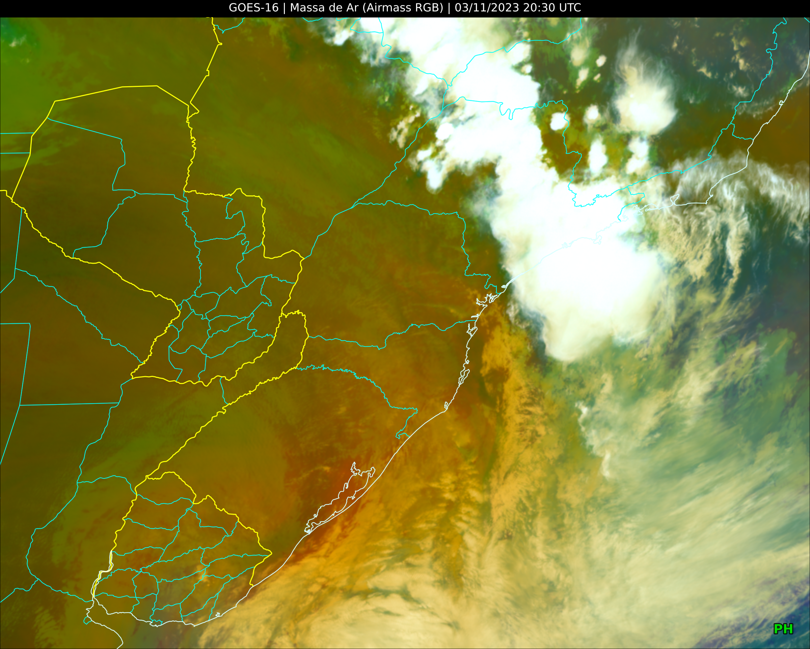
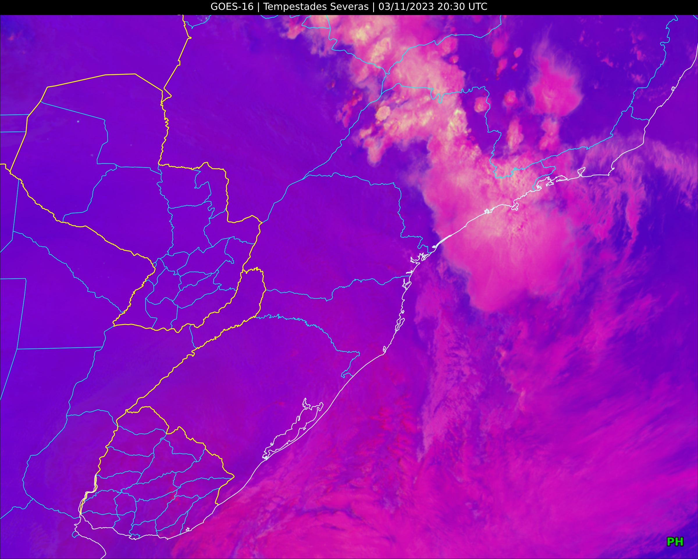
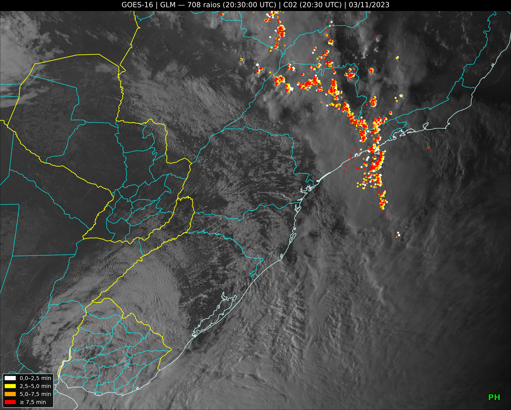

# GOES Image Generator

Gera imagens e vídeos a partir dos satélites GOES-16/GOES-19, focado na América do Sul. Baixa os NetCDF direto do bucket público da NOAA na AWS (acesso anônimo, sem credenciais), recorta a região configurada, aplica as paletas/receitas de `colors.ini` e renderiza com matplotlib/cartopy. Dá pra gerar uma imagem única, montar um vídeo com FFmpeg ou só uma sequência de imagens de um período, sem vídeo. O formato das imagens exportadas (png, webp, jpg ou tiff) é escolhido em `image_format`.

Toda a configuração (produto, período, mapa, cores, performance) fica em `config.ini` e `colors.ini`, com explicações sobre todos os parâmetros. Esse README cobre o que os `.ini` não explicam: a arquitetura por trás de `product =`.

---

## O que o projeto suporta

Bandas ABI individuais: `C01` a `C16`. C01-C06 (refletância) saem em cinza; C07-C16 usam a paleta em `[PALETTE_C07..16]`.

Multiespectrais: `GEOCOLOR` (aproximação true-color/IR do produto CIRA GeoColor) e `SPLIT_WINDOW` (C13 - C15).

Composições RGB: `AIRMASS`, `DAY_CLOUD_PHASE`, `NIGHT_MICROPHYSICS`, `SEVERE_STORMS`, `OVERSHOOTING_TOPS`, `FIRE_TEMPERATURE`. Cada uma é uma receita em `colors.ini` (faixa física, gama e inversão são livres; as bandas só podem variar entre as que o produto já baixa, lista no topo da seção RGB de `colors.ini`), não código fixo.

Produtos de nuvem: `CLOUD_TOP_HEIGHT` (produto oficial `ABI-L2-ACHAF`) e `CLOUD_BASE_HEIGHT`/`CLOUD_THICKNESS`, que são estimativas deste projeto (veja o aviso em `colors.ini` e "Limitações conhecidas" abaixo).

GLM: `product = GLM`, configurado na seção `[GLM]` de `config.ini`. Dois modos (`render_mode`): `POINTS` (raios individuais, cor/tamanho por idade) e `DENSITY` (grade 2D de contagem de raios). Nos dois modos, `[GLM] background` aceita qualquer produto da lista acima como plano de fundo, inclusive outra composição RGB, o GEOCOLOR ou um produto de nuvem. Quando o fundo tem barra de cores (bandas térmicas, SPLIT_WINDOW e produtos de nuvem), ela sai à direita do mapa. Com `background` vazio o PNG sai com fundo transparente de verdade (canal alpha), em qualquer `render_mode`, com ou sem `clean_mode` e `hide_map_lines`. Em vídeo isso não se mantém: o MP4 não tem canal alpha e mostra o fundo preto. Para ter os frames transparentes, use `generation_type = S` (sequência de imagens, PNGs direto em `satelite_images/`) ou `generation_type = I`.

Só existem imagens ABI "Full Disk" (disco completo) a cada 10 minutos, modo de escaneamento 6 (GOES-16 só passou a esse modo em abril/2019; CONUS e mesoescala não são suportados). GLM (`GLM-L2-LCFA`) tem um arquivo a cada 20 segundos. Troca automática de satélite: antes de 2025-04-07 15:10 UTC usa o GOES-16; a partir daí, o GOES-19.

### Produtos e arquivos que cada um baixa

Cada frame baixa os NetCDF listados abaixo (um por linha da coluna "Arquivos"). Quanto mais arquivos, mais RAM e rede por worker, então ajuste `num_workers` olhando esta tabela.

| `product =` | Arquivos por frame | Quando faz sentido |
|---|---|---|
| `C01` a `C06` | 1 banda ABI (`CMIPF`) | Só de dia (refletância) |
| `C07` a `C16` | 1 banda ABI (`CMIPF`) | Dia e noite (C07 tem reflexo solar de dia) |
| `SPLIT_WINDOW` | C13, C15 | Dia e noite |
| `AIRMASS` | C08, C10, C12, C13 | Dia e noite |
| `DAY_CLOUD_PHASE` | C02, C05, C13 | Só de dia |
| `NIGHT_MICROPHYSICS` | C07, C13, C15 | Feito pra noite |
| `SEVERE_STORMS` | C02, C05, C07, C08, C10, C13 | Só de dia |
| `OVERSHOOTING_TOPS` | C08, C12, C13 | Dia e noite |
| `FIRE_TEMPERATURE` | C05, C06, C07 | Dia |
| `GEOCOLOR` | C01, C02, C03, C13 | Dia e noite (transição pelo ângulo solar) |
| `CLOUD_TOP_HEIGHT` | `ACHAF` | Dia e noite |
| `CLOUD_BASE_HEIGHT`, `CLOUD_THICKNESS` | `ACHAF`, `CODF`, `ACTPF` | Dia e noite, mas é estimativa e à noite o COD só é confiável de 1 a 8 |
| `GLM` | 1 arquivo GLM (20 s) + histórico se `POINTS` com `flash_age = True` + os arquivos do fundo escolhido | Dia e noite |

---

### Exemplos de renderização

<p align="center">
  <br>
  <small><i>Modo vídeo (C13, infravermelho)</i></small>
</p>

<table border="0" width="100%">
  <tr>
    <td align="center" width="50%">
      <br>
      <small><i>GEOCOLOR (true-color de dia, IR à noite)</i></small>
    </td>
    <td align="center" width="50%">
      <br>
      <small><i>AIRMASS (composição RGB)</i></small>
    </td>
  </tr>
  <tr>
    <td align="center" width="50%">
      <br>
      <small><i>SEVERE_STORMS (composição RGB)</i></small>
    </td>
    <td align="center" width="50%">
      <br>
      <small><i>C02 (visível) com GLM por cima</i></small>
    </td>
  </tr>
</table>

---

## Instalando

Python 3.10+. Cartopy precisa de GEOS/PROJ instalados no sistema, então o caminho mais tranquilo é usar Conda:

```bash
git clone https://github.com/ArthurPH25/goes-image-generator.git
cd goes-image-generator
conda create -n goes python=3.11
conda activate goes
conda install -c conda-forge cartopy
pip install -r requirements.txt
```

Pip puro também funciona, mas instalar o Cartopy vira um problema à parte dependendo do sistema operacional. Resolve GEOS/PROJ antes de rodar o `pip install`.

O FFmpeg não precisa estar instalado nem no PATH (`imageio-ffmpeg` traz o binário). Em servidor, use `open_video_when_done = False`. A primeira execução precisa de internet pro Cartopy baixar os dados de fronteiras/costa (Natural Earth); nas seguintes já está em cache local. Com `hide_map_lines = True` esse download nem é feito.

Ajuste `config.ini` (produto, data/hora, coordenadas, performance) e `colors.ini` (paletas/receitas) na raiz do projeto e rode:

```bash
python index.py
```

Roda de qualquer diretório: os dois `.ini` são lidos da pasta do script. Valida tudo antes de baixar qualquer coisa.

## Arquitetura: como um produto vira uma imagem

```
config.ini [GENERAL] product = X
        │
        ▼
products/registry.py    sabe quais arquivos X precisa do bucket da NOAA
        │               (SourceSpec) e qual função sabe desenhá-lo (renderer)
        ▼
index.py                lista e baixa esses arquivos para o timestamp certo
        │
        ▼
products/<módulo>.py    lê o(s) NetCDF e devolve um LayerResult padronizado
   (abi / clavr)        (kind="mono": array 2D + colormap; kind="rgb":
        │               array (H,W,3) já pronto)
        ▼
products/pipeline.py    desenha o LayerResult nos eixos do mapa, com
                        linhas, colorbar e título quando aplicável, e a
                        marca d'água sempre que `watermark` não for vazio,
                        e salva a imagem no formato de image_format
```

Módulos de `products/`: `core.py` (geometria da projeção, recorte, reamostragem, `LayerResult`), `abi.py` (leitura das bandas ABI, bandas individuais, SPLIT_WINDOW, composições RGB e GEOCOLOR), `clavr.py` (produtos de nuvem), `pipeline.py` (desenho comum), `registry.py` (mapa produto, fontes e renderer) e `glm.py` (relâmpagos).

`products/glm.py` não passa por `pipeline.generate_standalone_image`: ele tem fluxo próprio (`GLM.generate_image`) porque desenha pontos/grade *por cima* de um fundo opcional. Esse fundo é resolvido pela mesma `pipeline.render_layer()` usada por qualquer outro produto, e é por isso que o GLM aceita qualquer coisa como fundo sem duplicar lógica de desenho.

Bandas ABI de resoluções nativas diferentes (0.5/1/2 km) aparecem juntas em várias composições RGB e no GEOCOLOR. `products/core.py::align_bands_to_reference` reamostra todas pra grade da banda mais grosseira da receita, por vizinho mais próximo em coordenadas de scan angle (não por índice de pixel), então o alinhamento geográfico se mantém mesmo com margens de recorte ligeiramente diferentes entre arquivos.

Adicionar um produto novo = 4 passos: (1) escrever um `render(nc_paths, config, colors_config, map_geo, product_spec, target_dt) -> LayerResult` num módulo de `products/`; (2) registrar em `products/registry.py::build_registry()` com suas `SourceSpec` (se o `kind` for novo, inclua também um ramo em `validate_product_colors` e, se ele puder ser fundo do GLM, em `_rebuild_cmap_for_background` de `products/glm.py`); (3) adicionar a seção de paleta/receita correspondente em `colors.ini`; (4) acrescentar o nome do produto na lista de valores aceitos nos comentários de `[GENERAL]` em `config.ini`. Não precisa tocar em `index.py` nem em `pipeline.py`.

## Limitações conhecidas (leia antes de usar em produção)

- GEOCOLOR é uma aproximação: true-color sintético de dia (o GOES não tem banda verde real, então o verde é uma combinação de C01/C02/C03) e IR realçado à noite, com transição pelo ângulo zenital solar calculado localmente. Não tem o mosaico de luzes noturnas nem o realce de neve/gelo do produto oficial do CIRA.
- CLOUD_BASE_HEIGHT e CLOUD_THICKNESS são estimativas, não um produto público oficial (esse produto não existe no bucket da NOAA, e o que o CIRA/SLIDER mostra sai de um pipeline à parte). Aqui a espessura vem de uma parametrização simples em cima de `COD` (profundidade óptica, `ABI-L2-CODF`) e `Phase` (`ABI-L2-ACTPF`), com coeficientes editáveis em `colors.ini [ESTIMATE_CLOUD_GEOMETRY]`. Use só como visualização experimental.
- As receitas das composições RGB (`RGB_AIRMASS`, `RGB_SEVERE_STORMS` etc. em `colors.ini`) seguem os quick guides públicos da NOAA/CIRA para o ABI e da EUMETSAT, com uma exceção: `OVERSHOOTING_TOPS` não tem guia publicado com esses números, é uma receita experimental inspirada no Tropical Airmass (detalhes em `colors.ini`). O `SEVERE_STORMS` segue a receita Severe Storms da EUMETSAT, com gama 0,5 no verde; o Day Convection da NOAA tem as mesmas faixas, mas gama 1 no verde. A gama segue a convenção EUMETSAT/CIRA, saída = valor ^ (1 / gama). Se notar diferença contra uma imagem de referência confiável, ajuste `min`/`max`/`gamma` sem mexer em código.

## Como funciona por dentro (detalhes de execução)

A validação de `config.ini`/`colors.ini` roda logo no início do `index.py`, antes de qualquer coisa tocar rede. Nessa etapa também é calculada a `render_signature`, um SHA1 de 12 caracteres com tudo que muda a aparência do frame: produto, `[MAP]`, `[STYLE]` inteiro, dpi, e as seções de `colors.ini` relevantes pro produto ativo (incluindo, no caso do GLM, as do produto de fundo). Data e horário ficam de fora de propósito.

Essa assinatura define a pasta `satelite_temp_images/<assinatura>/` no modo vídeo. Mudar só o período reaproveita frames já renderizados; mudar qualquer coisa visual gera pasta nova.

A busca no S3 roda sequencial, fora dos processos de renderização, uma listagem por hora de dados (e por fonte, quando o produto pede mais de um arquivo: RGBs, nuvem ou GLM com fundo). A renderização distribui cada timestamp entre `num_workers` processos separados; cada worker baixa os arquivos que o produto daquele frame precisa.

Fundo do GLM em modo vídeo ou sequência de imagens: renderizado (não só baixado) uma única vez por bloco de 10 minutos e guardado em cache (`satelite_temp_downloads/glm_nc_cache/bg_*.npz`), reaproveitado pelos ~30 frames de 20s daquele bloco. A trava (`.lock`) tem limite de 5 min; se estourar, o frame sai sem fundo com aviso.

Demais comportamentos de borda (satélite ausente no bucket, PNG corrompido, trava de instância única, limpeza de pastas temporárias) seguem exatamente como documentado nos comentários de `config.ini`.

## Pastas de saída

| Pasta | Conteúdo | Sobrevive entre execuções? |
|---|---|---|
| `satelite_images/` | Imagens do modo imagem única (`<PRODUTO>_<timestamp>.<ext>`, ext conforme `image_format`) | Sim, nunca sobrescreve |
| `satelite_images/<PRODUTO>_<início>_a_<fim>/` | Imagens do modo sequência (`<PRODUTO>_<AAAAMMDD>_<HHMM>.<ext>`, GLM com segundos) | Sim, cada execução cria uma pasta nova |
| `satelite_videos/` | MP4s do modo vídeo (`satelite_<PRODUTO>_<início>_a_<fim>.mp4`) | Sim |
| `satelite_temp_images/<assinatura>/` | Frames do modo vídeo (sempre PNG) | Só se `delete_temp_images = False` |
| `satelite_temp_downloads/` | NetCDF baixados na execução | Não |
| `satelite_temp_downloads/glm_nc_cache/` | Histórico do GLM + cache de fundo (`.npz`) | Não |
| `satelite_temp_downloads/instance.lock` | Trava de execução única | Não, expira em 24h se sobrar |

## Solução de problemas comuns

| Sintoma | O que fazer |
|---|---|
| Erro de validação logo no início | Leia a mensagem: ela aponta a chave do `.ini`. Confira `product` contra a lista em `[GENERAL]`, formato do horário (`HH:MM` vs `HH:MM:SS` no GLM) e comentário na mesma linha do valor. |
| "fonte(s) não encontrada(s) no bucket" | Um dos arquivos que o produto escolhido precisa (banda ABI ou `ACHAF`/`CODF`/`ACTPF`) não existe pra esse instante. Confira data/hora em UTC e se o período é suportado. |
| "Já existe outra execução..." | Apague `satelite_temp_downloads/instance.lock` se tiver certeza de que não há execução ativa. |
| GLM sem `background` sai com fundo preto no vídeo | É o MP4, que não tem transparência. Os PNGs continuam transparentes: use `generation_type = S` para recebê-los direto em `satelite_images/<PRODUTO>_.../`. |
| GLM com fundo sempre "sem fundo" | Confira `[GLM] background` contra a lista de produtos válidos e se esse produto tem paleta/receita completa em `colors.ini`. |
| Vídeo GLM com frames "sem fundo" às vezes | Muitos workers disputando o mesmo cache de fundo. Reduza `num_workers`. |
| O processo morre sozinho no meio | Falta de RAM. Reduza `num_workers` primeiro (produtos com várias bandas/fontes pesam mais), depois `dpi`/`figure_width`/`figure_height`. |
| Cores de uma composição RGB/GeoColor parecem erradas | Ajuste `min`/`max`/`gamma`/`invert` da seção `[RGB_*]` correspondente em `colors.ini`. São só números, não precisa mexer em código. Gama abaixo de 1 escurece, acima de 1 clareia. |
| Erro de validação dizendo que a receita usa banda que o produto "não baixa" | Você trocou uma banda da receita por outra que o produto não baixa. Use uma das bandas listadas em `colors.ini` para aquele produto ou inclua a nova banda nas fontes dele em `products/registry.py`. |
| Erro dizendo que `target_coordinates` está fora do disco visível | O recorte está numa região que o GOES-East não enxerga (ele cobre de uns -156 a 6 de longitude). Revise `[MAP] target_coordinates`. |
| A imagem sai com horário diferente do esperado | Todos os horários do `config.ini` são UTC. Horário de Brasília é UTC-3, então 16:30 em Brasília é `19:30` no arquivo. |

## Créditos

- Dados: satélites GOES-R da NOAA/NASA, via [NOAA Open Data Dissemination na AWS](https://registry.opendata.aws/noaa-goes/) (buckets `noaa-goes16` e `noaa-goes19`).
- Mapas: [Natural Earth](https://www.naturalearthdata.com/), via Cartopy.
- Receitas de RGB/GeoColor: quick guides públicos da EUMETSAT, CIMSS e CIRA (ver aviso de precisão em `colors.ini`).

## Licença

[MIT](LICENSE).